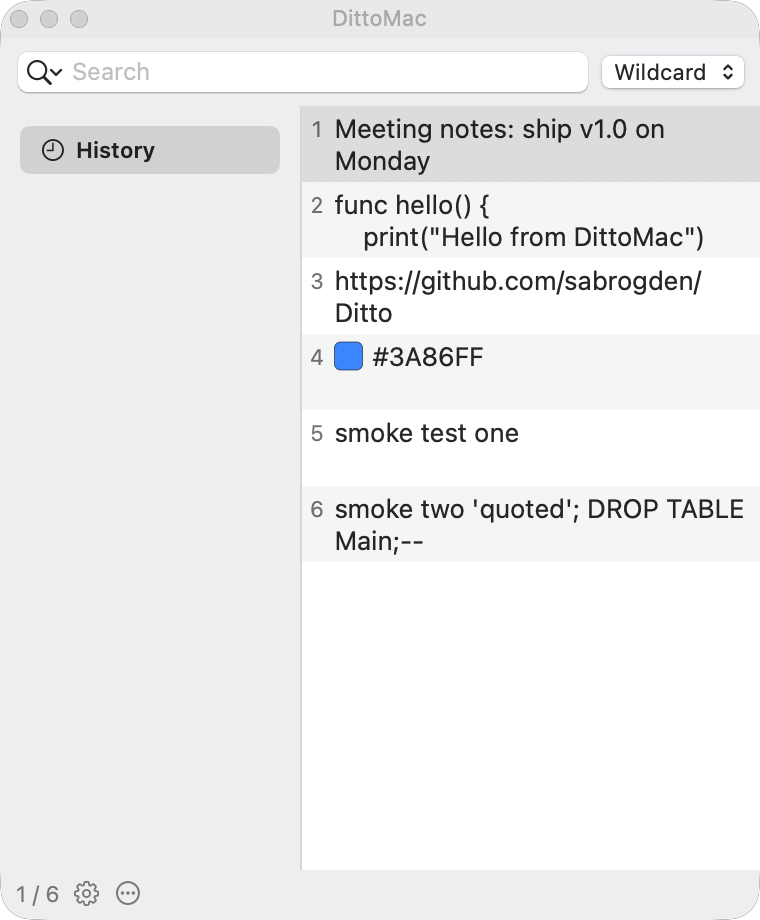

<p align="center"></p>

<h1 align="center">DittoMac</h1>

<p align="center">
An unofficial native macOS port of <a href="https://github.com/sabrogden/Ditto">Ditto</a>, the clipboard manager for Windows.<br>
Universal app for Apple silicon (M1–M5) and Intel Macs · macOS 13 Ventura or later · GPL-3.0
</p>

---

DittoMac keeps everything you copy in a local database. You can search it, organise it, transform it and paste it
back from a fast keyboard popup. It ports the behaviour of **Ditto 3.25.113.0** (groups, sticky clips, special paste,
copy buffers, themes and more) as a native Swift/AppKit app. No Wine and no Electron.

> DittoMac is a community port and is not affiliated with the original Ditto project. All credit for the original
> design goes to Scott Brogden and the Ditto contributors.

<p align="center"></p>

## Install

1. Download `DittoMac-<version>-universal.dmg` from [Releases](https://github.com/NazmulGit/DittoMac/releases).
2. Open the DMG and drag **DittoMac** onto **Applications**.
3. First launch: the app is open-source and ad-hoc signed, not notarized by Apple. **Right-click → Open**, or go to
   *System Settings → Privacy & Security → Open Anyway*. As an alternative:
   ```bash
   xattr -dr com.apple.quarantine /Applications/DittoMac.app
   ```
4. Grant **Accessibility** when asked (*System Settings → Privacy & Security → Accessibility*). DittoMac needs it to
   type ⌘V into the app you were using. Without it, clips are still placed on the clipboard for you to paste.

Verify the download (optional):
```bash
shasum -a 256 -c DittoMac-1.0.0-universal.dmg.sha256
```

## Use

| Action | Keys |
|---|---|
| Open Quick Paste | **⌃`** (Control + backtick). Configurable, plus two alternates |
| Paste selected (default format) / plain text | Return / ⇧Return (or double-click) |
| Paste as Markdown | ⌥⇧Return |
| Save clip as RTF/RTFD, web archive, HTML, Markdown, text or PNG | ⌘⇧S |
| Paste position 1–10 | ⌘1 … ⌘0 (⌥⌘ for plain text) |
| Search | just type (wildcard `*`, `OR`, `NOT`, `"phrases"`; `/f` full text, `/q` quick-paste text) |
| Preview / Edit / Properties | Space or F3 / ⌘E / ⌘I |
| New clip / new group / groups sidebar | ⌘N / ⌃⌘N / ⌘G |
| Group from selection | F7 or ⌘⇧N |
| Always on top | ⌃Space |
| Copy without pasting | ⌘C |
| Delete | ⌘⌫ or ⌦ |
| Back to parent group / History | ⌘↑ / Home |
| Hold ⌃ and press ` repeatedly | moves down the list, then releasing ⌃ pastes, as in Ditto |

Right-click a clip for **Paste As** / **Copy As** (Original, Plain Text, Rich Text without images, Markdown,
HTML Source), **Save Clip As…**, **Special Paste** (UPPER, lower, Capitalize, Sentence case, Invert, Trim, CamelCase,
ASCII-only, remove line feeds, +line feed(s), +current time, Typoglycemia, Slugify, stitched images), stickies,
ordering, groups, QR code, compare, web search, translate, share, export and *Send To* friends.

## Features

- **Capture:** text, rich text, HTML, images and file references, with per-type control, include/exclude apps,
  size limits and duplicate handling. Password-manager clips are never stored.
- **Full formatting:** copies from Safari, Notes, Pages or Mail keep their headings, styles and pictures (web
  archives, RTFD, JPEG/GIF/HEIC, PDF, links), so pasting into Notes brings the whole layout back. Choose a default
  paste format, always paste plain text into chosen apps, or paste/copy/save any clip as plain text, rich text,
  Markdown or HTML. Previews never load anything from the web.
- **Quick Paste popup:** caret, cursor or last position; 1–5 lines per row; thumbnails; colour-code swatches;
  first-ten numbers; pasted indicator; transparency; 12 Ditto themes plus System.
- **Groups:** nested groups with a sidebar, move/copy to group, group hotkeys (double-press to file the next copy),
  and open-to-group-by-app.
- **Sticky clips, never-auto-delete, per-clip global hotkeys, quick-paste text**
- **Copy buffers:** 5 extra clipboards with their own copy/cut/paste hotkeys.
- **Copy Rules:** ignore, rewrite (regex), strip to plain text, make sticky or file into a group, matched by app or
  text. These replace Ditto's ChaiScript and regex filters, safely.
- **Retention:** max entries, expiry by last use, delete unused, delete clip data by filter, compact, backup/restore.
- **Import your Windows Ditto history** (`Ditto.db`), export/import `.dittoclips`, export to text or image files.
- **Friends:** share clips between your Macs on the local network, end-to-end encrypted. Off by default.
- **Launch at login, menu-bar icon, optional Dock icon**

The full parity matrix against Windows Ditto is in [docs/FEATURES.md](docs/FEATURES.md).

## Security

Read [SECURITY.md](SECURITY.md). In short: bound SQL everywhere, no plug-in or script execution, password-manager
clips skipped, a `0600` database, a hardened runtime, and an authenticated, encrypted LAN protocol that is off by
default. The weaknesses found in upstream's network code are documented in
[docs/kb/security-review-upstream.md](docs/kb/security-review-upstream.md) and were not carried over.

## Build from source

You only need the Xcode **Command Line Tools** (`xcode-select --install`). The full Xcode app is not required.
```bash
git clone https://github.com/NazmulGit/DittoMac.git && cd DittoMac
scripts/test.sh                 # unit tests (swift-testing)
scripts/build_app.sh 1.0.0      # universal, signed dist/DittoMac.app
scripts/make_dmg.sh 1.0.0       # dist/DittoMac-1.0.0-universal.dmg
```

## Documentation

| Doc | What |
|---|---|
| [docs/ARCHITECTURE.md](docs/ARCHITECTURE.md) | Modules, API contract, keyboard map |
| [docs/FEATURES.md](docs/FEATURES.md) | Feature parity with Ditto 3.25.113.0 |
| [docs/PLAN.md](docs/PLAN.md) | Decisions and roadmap |
| [docs/RELEASE.md](docs/RELEASE.md) | How releases are built and published |
| [docs/RESOURCES.md](docs/RESOURCES.md) | Upstream and Apple references |
| [docs/kb/](docs/kb) | Knowledge base: data model, platform notes, themes, protocol, rich formats, security reviews |
| [CHANGELOG.md](CHANGELOG.md) | Release history |

## License

GPL-3.0, the same as upstream Ditto. See [LICENSE](LICENSE).
