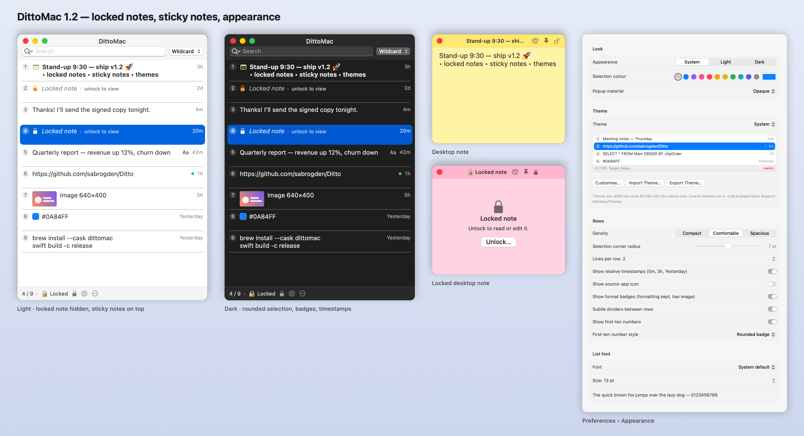

# Feature parity matrix: Ditto 3.25.113.0 (Windows) → DittoMac 1.0

Legend: ✅ ported · 🔁 redesigned for macOS / security · ⛔ not applicable on macOS (reason given) · 🗺 roadmap

Upstream catalog source: `research/ditto-src` (file refs in `docs/kb/`).

## 1. Capture
| Upstream feature | DittoMac |
|---|---|
| Clipboard monitoring, connect/disconnect toggle | ✅ NSPasteboard polling; menu "Connected to Clipboard", title shows "[Disconnected]" |
| "Clipboard Viewer Ignore" marker | 🔁 honours `org.nspasteboard.ConcealedType/TransientType/AutoGeneratedType`, 1Password etc. |
| Own pastes not re-captured | ✅ `org.dittomac.internal` marker |
| Include/exclude apps (wildcards, `;`) | ✅ on bundle id or app name |
| Supported types list, add types, Support All Types | ✅ text, RTF, HTML, image (PNG), file URLs + custom UTIs; full formatting set (see §11) |
| Max clip size | ✅ |
| Description from first N chars / "Copied File(s)" | ✅ |
| Duplicate handling (CRC, allow dups, back-to-back) | ✅ |
| Regex exclusions (15 slots) | 🔁 Copy Rules with `ignore` action (unlimited) |
| On-copy ChaiScript | 🔁 Copy Rules (declarative; no code execution) |
| Play sound on copy | ✅ system sound picker |
| Quick copy into group (double hotkey) | ✅ group global hotkey ×2 → ⌘C → next clip filed to group |
| Save current clipboard / copy-and-save | ✅ |
| Copy/paste statistics | ✅ |

## 2. Quick Paste popup
| Upstream | DittoMac |
|---|---|
| Global activate hotkey (Ctrl+`) + 2 extra | ✅ default ⌃` ; two optional extra |
| Hotkey again hides | ✅ |
| Hold modifier + re-press to move, release to paste | ✅ |
| Position at caret / cursor / previous | ✅ caret via Accessibility, falls back to cursor |
| Always on top (Ctrl+Space), auto roll-up | ✅ always-on-top; ⛔ roll-up (Windows caption metaphor) |
| Lines per row 1–5, row symbols, first-ten index, pasted indicator | ✅ |
| Thumbnails, RTF rendering, colour-code swatches | ✅ |
| Transparency presets | ✅ |
| Multi-select, select all | ✅ |
| Drag clips out to other apps | ✅ |
| Mouse bindings for actions | ✅ click/double-click/right-click defaults; 🗺 custom mouse mapping |
| Caption position (right/bottom/left/top) | ⛔ native macOS title bar |
| Show in taskbar / tray icon | 🔁 menu-bar icon; optional Dock icon |

## 3. Search
| Upstream | DittoMac |
|---|---|
| Find-as-you-type (250 ms), Enter to search | ✅ |
| Scopes: description / full text / quick-paste text, `/q` `/f` prefixes | ✅ |
| Modes: wildcard (AND/OR/NOT, quotes, `*`), contains, regex; toggle | ✅ (regex bounded) |
| Search history (10) | ✅ |
| Search within group, filter on selected clip, cancel filter | ✅ |

## 4. Groups
| Upstream | DittoMac |
|---|---|
| Nested groups, enter/back/home | ✅ |
| Groups tree (Ctrl+G) | ✅ sidebar (⌘G) |
| New group, new group from selection, move to group dialog | ✅ |
| Last-group toggle | ✅ |
| Group hotkeys (open / quick save into group), move-to-group hotkey | ✅ |
| Open to group by active app name, revert to top level on close | ✅ |

## 5. Paste
| Upstream | DittoMac |
|---|---|
| Paste selected (Enter / double-click), send paste vs only load clipboard | ✅ |
| Plain text (Shift+Enter) + global text-only paste hotkey | ✅ |
| Paste positions 1–10 (Ctrl+1…0) incl. plain-text variants | ✅ ⌘1…⌘0, ⌥⌘1…⌥⌘0 plain |
| Global "last ten" position hotkeys | ✅ |
| Paste without changing order; update order on paste | ✅ |
| Multi-paste with separator, reverse order, save multi-paste | ✅ |
| Multiple images stitched horizontally/vertically | ✅ |
| Special paste: UPPER, lower, Capitalize, Sentence, Invert, Trim, CamelCase, ASCII only, Remove line feeds, +1/+2 line feeds, +current time, Typoglycemia, Slugify | ✅ all |
| Paste script | 🔁 Copy Rules / transforms |
| Per-app paste key strings | ⛔ macOS uses ⌘V universally |
| Copy file contents into clip (CF_HDROP data) | 🗺 |

## 6. Edit / view
| Upstream | DittoMac |
|---|---|
| New clip, edit clip (built-in editor, rich text) | ✅ |
| External editor paths | 🗺 |
| Description window (text/RTF/HTML/image zoom, N/P, wrap) | ✅ + RTFD with inline images, "Formats:" line |
| Compare two clips | 🔁 built-in side-by-side line diff (no external diff app needed) |
| QR code | ✅ local CoreImage (no web service) |
| Web search / translate | ✅ https templates only, properly encoded |

## 7. Clip properties & ordering
| Upstream | DittoMac |
|---|---|
| Description, dates, never-auto-delete, hotkey (+global), move-to-group hotkey, group, quick-paste text, formats list + delete format + checksum | ✅ |
| Quick properties menu | ✅ |
| Sticky: top / last / remove / replace top | ✅ |
| Move to top / up / down / last | ✅ |

## 8. Retention & DB
| Upstream | DittoMac |
|---|---|
| Max entries, expiry by last-paste age, protection rules | ✅ (max entries on by default: 500) |
| Delete non-used clips, delete all, delete clip data window, compact | ✅ |
| Backup / restore database, choose DB path | ✅ backup/restore; 🗺 custom path |

## 9. Preferences pages
General · Quick Paste · Keyboard (global hotkeys) · Copy Buffers · Types · Friends · Rules (replaces regex/scripts) · Stats · Advanced — ✅

## 10. Other
| Upstream | DittoMac |
|---|---|
| Copy buffers (5, global copy/paste/cut hotkeys) | ✅ |
| Global hotkeys list window | ✅ (Keyboard prefs page) |
| Themes (12 + system) | ✅ |
| Languages (29 XML files keyed by Win32 IDs) | 🗺 English in 1.0; strings centralised for translation |
| Export / import clips (.dto) | 🔁 `.dittoclips` export/import + **import Windows Ditto.db** (migration) |
| Export to text files / image files | ✅ |
| Email clip (body / attachment), Gmail | 🔁 macOS Share menu (Mail, Messages, AirDrop…) |
| Friends (send clips over LAN) | 🔁 secure redesign, off by default (see SECURITY.md) |
| Add-in DLLs | ⛔ removed (unsigned code loading) — built-in equivalents |
| Portable/INI mode, elevation, U3, DPI | ⛔ Windows-specific |
| Launch at login | ✅ SMAppService |
| Check for updates | 🔁 "Check for updates" opens GitHub Releases page (no auto-download) |

## 11. Rich formatting & paste formats (DittoMac 1.1)
DittoMac addition (upstream Ditto stores CF_HTML/RTF but has no paste-format chooser). Details and security notes:
[docs/kb/rich-formats.md](kb/rich-formats.md).

| Feature | DittoMac |
|---|---|
| Keep full formatting (Preferences › Types, on by default) | ✅ also stores `com.apple.webarchive` (legacy "Apple Web Archive pasteboard type" normalised), `com.apple.flat-rtfd`, `public.rtfd`, `public.jpeg`, `com.compuserve.gif`, `public.heic`, `com.adobe.pdf`, `public.url`, `public.url-name` — exact bytes, 64 MiB per format, total still capped by max clip size |
| Rich-only sources (RTFD/HTML without plain text) | ✅ plain text derived locally for the description and full-text search |
| Paste formats | ✅ Original (all formats) · Plain Text · Rich Text (RTF, no images) · Markdown · HTML Source |
| Default paste format (Return, double-click, ⌘1…⌘0, global last-ten and clip hotkeys) | ✅ Preferences › Quick Paste |
| Always paste plain text into chosen apps | ✅ `;`-separated wildcards on bundle id or app name |
| Paste As ▸ / Copy As ▸ context submenus | ✅ single and multi-clip (Markdown / text joined with the multi-paste separator) |
| Paste as Markdown | ✅ ⌥⇧Return; HTML → Markdown (headings, lists, tables, code, safe links/images), RTF/RTFD → Markdown |
| Save Clip As… (⌘⇧S) | ✅ .rtf / .rtfd, .webarchive, .html, .md, .txt, .png; one file per clip for multi-selection |
| Row indicators | ✅ subtle "rich formatting" and "image + text" symbols |
| Preview | ✅ RTFD with local images; HTML / web-archive HTML via the allow-list sanitiser only |
| Friends sync of rich formats | 🗺 Friends still sends the core formats only (text, RTF, HTML, PNG, …) |

## 12. Locked notes, sticky notes, appearance (DittoMac 1.2)

### Locked notes (popup integration of the vault, see docs/kb/vault.md)
| Feature | Status |
|---|---|
| Lock / Lock N Clips (⌘L, context menu); first lock runs vault setup (Touch ID / Mac password, or a DittoMac password) | ✅ |
| Remove Lock… (⌘L when every selected clip is locked) · Lock Notes Now (⇧⌘L, More menu, status menu, bottom-bar lock button) · Unlock Notes… | ✅ |
| Rows: vault locked → lock icon + “Locked note · unlock to view”, no thumbnail / rich text / colour swatch / search highlight; vault unlocked → real text with a small orange lock badge | ✅ |
| Status line shows 🔒 Locked / 🔓 Unlocked once the vault is set up | ✅ |
| Return, double-click, ⌘1…⌘0, Copy, Paste As, Special Paste, global paste hotkeys, status-menu recent clips: unlock first, then continue | ✅ |
| Pasting / copying a locked note adds `org.nspasteboard.ConcealedType` so other clipboard managers skip it | ✅ |
| Preview, Edit, Properties, Save As, Compare, QR code, Web Search / Translate: prompt to unlock (work normally once unlocked) | ✅ |
| Drag-out disabled while locked; Share omits locked notes while locked | ✅ |
| Export (clips, text, images), Send To (Friends) and sync never include locked notes; FriendsService refuses them too | ✅ |
| Delete: unlocked items deleted normally; locked ones only via “Delete All…” → authenticate → “Delete this note?” (`VaultService.deleteLockedClips`); “Delete Others, Keep Locked” keeps them | ✅ |
| Menu-bar recent list shows “🔒 Locked note”, never the text | ✅ |
| Vault lock / unlock drops cached thumbnails and rich text and reloads the list | ✅ |

### Sticky notes
| Feature | Status |
|---|---|
| New Sticky Note… (⌥⌘N in the popup and app menu, context menu, More menu, status menu, Preferences) — editor in note mode: optional title, rich/plain text, Pin to top (default on → top sticky), Lock this note, Show on desktop, colour | ✅ |
| Notes appear at the top of the list with a note icon in their colour (title in bold) | ✅ |
| Show as Desktop Note (context menu): floating, resizable note window; colours yellow/green/pink/blue/purple/grey (light + dark variants); always-on-top toggle (pin); plain-text editing with 0.6 s autosave (re-encrypted when locked); remembered frame per note | ✅ |
| Desktop note lock button: lock the note / Lock Notes Now / Remove Lock…; a locked note shows “🔒 Locked note — Unlock…” and its text is never put in the window | ✅ |
| Restore desktop notes at launch (default on) | ✅ |

### Appearance (Preferences › Appearance, applied live)
| Feature | Status |
|---|---|
| Appearance System / Light / Dark (NSApp.appearance) | ✅ |
| Selection colour: theme default, 10-colour palette, custom colour | ✅ |
| Themes: all built-ins + System, custom themes, live preview; Import / Export JSON (≤ 64 KB, hex only, sanitised names); theme editor (12 colours) → Save as Custom Theme (~/Library/Application Support/DittoMac/Themes, 0600) | ✅ |
| Rows: density compact / comfortable / spacious, selection corner radius, lines per row, relative timestamps, source-app icon, format badges, dividers, first-ten number style (plain / badge / ⌘ keycap) | ✅ |
| List font family and size with preview; popup width / height; transparency; opaque or translucent (vibrancy) material | ✅ |
| Menu-bar icon (9 SF Symbols), dim when disconnected, “new clips since last opened” badge | ✅ |
| Restore Appearance Defaults | ✅ |
