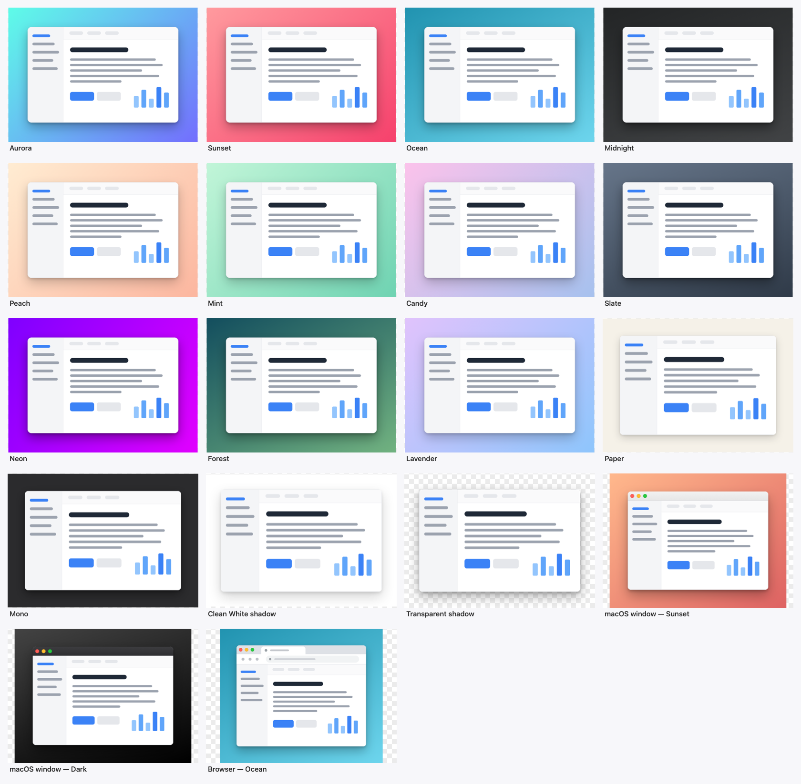

# Beautify (professional borders for screenshots)

Code: `Sources/DittoMac/UI/Screenshot/BeautifyRenderer.swift` (CoreGraphics), `BeautifyControls.swift` (SwiftUI), `BeautifySettings.swift`
(`Settings.beautifyDefaultStyle`); pure maths and the preset table in `Sources/DittoCore/BeautifyLayout.swift`; storage in
`Settings+Beautify.swift` (`beautifyDefaultStyle` JSON, `beautifyAutoApply` Bool, default off). Tests: `BeautifyLogicTests.swift`.



Regenerate the sheet with the command at the top of `docs/assets/make-beautify-sheet.swift` (it compiles the renderer next to a built DittoCore).

## Rendering
`BeautifyRenderer.render(image, pixelScale:, style:) -> CGImage`: offscreen `CGContext` (sRGB, premultiplied RGBA), no randomness or clock, so output is deterministic.
1. Layout (`BeautifyLayout.compute`), in points: image size = pixels ÷ `pixelScale`; the framed content is the image plus window chrome; canvas = content + 2 × padding; for an aspect preset the canvas grows (never shrinks) to the ratio and the content stays centred. Output pixels = canvas points × `pixelScale`.
2. Cap: longest side ≤ 16,384 px, and total ≤ 128 MP (≈ 512 MB), scaling everything down proportionally. Zero-size images, non-finite or non-positive scales, NaN styles and failed context creation return the input unchanged or a clamped result, never a crash.
3. Background: linear gradient (CSS angle: 0 = up, 90 = right, 135 = down-right; line length per CSS so corners reach the end colour), solid, or transparent (alpha kept).
4. Shadow: two passes (wide ambient + tight contact shadow) of the rounded content shape, y-offset downward; blur ≈ CSS blur radius.
5. Content clip: rounded rectangle (radius clamped to half the shorter side), content rect snapped to whole pixels so the screenshot stays sharp. Window chrome is drawn inside the same clip so the corners match: `macWindow` (28 pt light title bar, separator, red/yellow/green dots), `macWindowDark`, `browser` (64 pt: tab strip with traffic lights and a selected tab, toolbar with nav dots and a URL pill; no text).
6. Optional outline stroked inside the edge.

Colours are `#RGB`, `#RRGGBB` or `#RRGGBBAA` hex (`HexColor`); invalid hex falls back to a neutral grey. The SwiftUI side converts through `Color(beautifyHex:)` / `.beautifyHex` in sRGB.

## Presets
18 looks in `BeautifyPresetCatalog.specs` (Aurora, Sunset, Ocean, Midnight, Peach, Mint, Candy, Slate, Neon, Forest, Lavender, Paper, Mono,
Clean White shadow, Transparent shadow, macOS window — Sunset, macOS window — Dark, Browser — Ocean). Names are unique and values are range-checked by tests.
Choosing a preset sets `enabled = true`; editing any slider renames the style "Custom".

## UI
`BeautifyControls(style:)`: enable toggle, thumbnail grid (rendered from a synthetic sample and cached), background kind (gradient / solid / transparent) with colour pickers and angle, padding / corner / shadow sliders, window frame, aspect, outline width and colour.
`BeautifyDefaultsView()`: saves on every change to `beautifyDefaultStyle`, "Apply Beautify to every screenshot" toggle, live preview, Reset.

## For the capture flow
```swift
let style = Settings.shared.beautifyDefaultStyle
if Settings.shared.beautifyAutoApply || style.enabled { image = BeautifyRenderer.render(cg, pixelScale: backingScale, style: style) }
```
A transparent background only survives in PNG; JPG/BMP encoders must composite onto white themselves.
